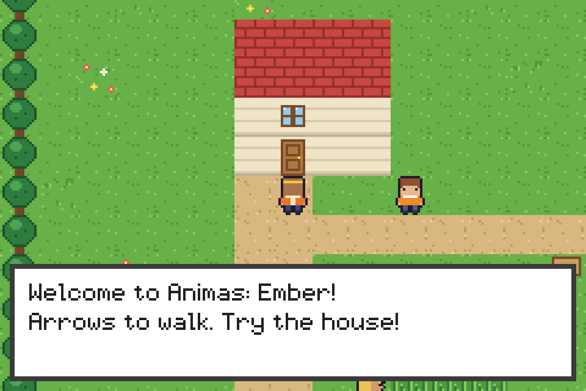
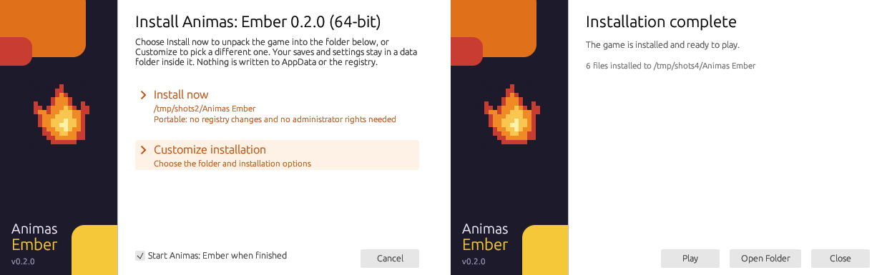
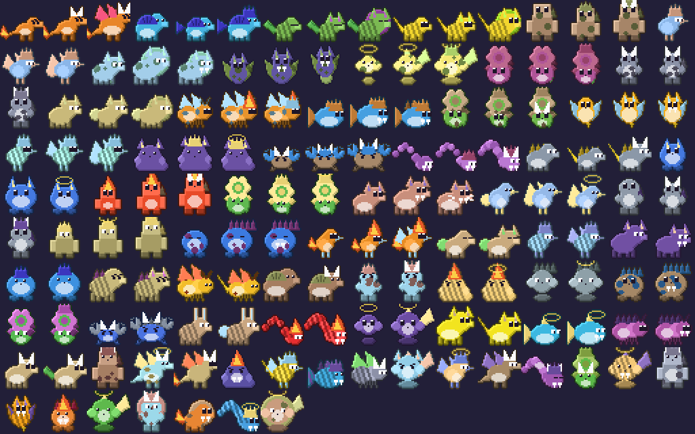
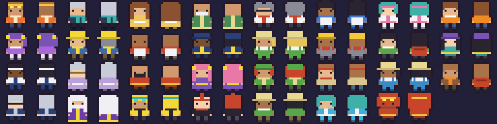

# Animas: Ember


**A creature-collecting, turn-based RPG built in Godot 4, in the spirit of the classic handheld monster-catching games.** Made by [Animas Software Foundation](https://github.com/Animas-Software-Foundation).

[](https://animas-software-foundation.github.io/Animas-Ember/)

> **Pre-alpha.** v0.2.0: explore the town and Route 1, meet all 151 animas, get challenged by trainers, and save your progress. Real battles, catching, and moves are on the roadmap below.

## Play it

- **Download a build:** grab your platform from the [latest release](https://github.com/Animas-Software-Foundation/Animas-Ember/releases/latest) (see [Downloads](#downloads)).
- **In your browser (no install):** <https://animas-software-foundation.github.io/Animas-Ember/>, the project website with a playable starter town. Works on phones with an on-screen D-pad.
- **In Godot:** see [Run the project](#run-the-project) below.

## Downloads

Every tagged release is built automatically for these platforms:

| Platform | Architectures | Files |
|----------|---------------|-------|
| Windows  | x86_64, x86_32 (32-bit), arm64 | `-setup.exe` installer, `-portable.zip`, or a plain `.zip` |
| Linux    | x86_64, x86_32 (32-bit), arm64, arm32 | `-setup.run` installer, `-portable.tar.gz`, or a plain `.tar.gz` |
| macOS    | Universal: Intel (x86_64) + Apple Silicon (arm64) | `-setup.run` installer, `-portable.zip`, or a plain `.zip` |
| Android  | arm64, arm32, x86_64, x86, or one universal APK | `.apk` |
| iOS      | arm64 | Xcode project (build it yourself with your Apple Developer account) |

**Installer or portable?** Both are *portable*: the game keeps your saves and settings in a `data` folder next to it, and writes nothing to AppData or your home folder, so you can move or copy the whole folder (to a USB stick, another PC) and take your progress with you. The **setup** file is a small self-extracting installer written in Rust. On Windows it is a graphical wizard (choose a folder, watch the progress, start the game when it finishes); on Linux and macOS it is a console installer. By default it unpacks into a folder next to the installer. Installing over an old version keeps your `data` folder. For unattended installs, run it with `--silent --dir <folder>` (Windows: `setup.exe /S /D=<folder>`).

 The plain archive is just the game, which behaves like a normal Godot game (data goes to the system's usual location).

Not sure which one? Windows, Mac, and most modern Android phones want the 64-bit builds (x86_64 / arm64 / universal). A `SHA256SUMS.txt` is attached to every release.

**First-run warnings are expected for now.** The builds are not yet signed with a paid certificate: on Windows choose *More info > Run anyway* in SmartScreen; on macOS right-click the app and choose *Open* (or use *System Settings > Privacy & Security > Open Anyway*); on Android allow installing from your browser or file manager.

## What's in v0.2.0

- **Save and Continue:** the game autosaves and picks up where you left off. Saves live next to the game (see Downloads)
- **A menu** (Esc, or MENU on touch screens): Animadex, Save game, New game, Resume
- **151 original animas** in 71 evolution families across 12 types, each with its own sprite, stats, and dex entry (see below)
- **The Animadex:** open it from the menu to browse them all
- **Trainers with line of sight** who spot you, walk up, and challenge you. Battles come in a later update
- **Wild animas** hiding in tall grass, with per-map encounter tables
- **31 unique character looks:** the hero, villagers, and every trainer have their own hair, outfit, and accessories
- A starter town, a house, and **Route 1**, linked by door and route warps with fade transitions
- Grid-based, tile-by-tile movement. Tap a direction to turn, hold it to walk
- An original 16x16 tileset, and a hand-drawn bitmap font (*Animas Pixel*) that stays crisp at any size
- On-screen touch controls on phones and tablets
- Automated builds for Windows, Linux, macOS, Android (and iOS) on every release
- A headless smoke test that covers movement, warps, NPCs, the roster, the menu, saving and continuing, encounters, and trainer challenges

## Meet the animas

All 151 are original: names, designs, and stats. Twelve types (Ember, Tide, Bloom, Volt, Stone, Gale, Frost, Shade, Lumen, Venom, Iron, Wild), 30 three-stage lines, 20 two-stage lines, and 21 standalone animas. Browse them with filters on [the website](https://animas-software-foundation.github.io/Animas-Ember/#animas) or in-game with the Animadex.



## Everyone has a face

Every character has a unique look, from the hero to the elder to each trainer.



## Run the project

**Requirements:** [Godot 4.7 or newer](https://godotengine.org/download) (the standard build, not .NET).

```bash
git clone https://github.com/Animas-Software-Foundation/Animas-Ember.git
```

Open Godot, click **Import**, choose `project.godot`, then press **F5**.

## Controls

| Action                  | Keys                  |
|-------------------------|-----------------------|
| Move / turn             | Arrow keys or D-pad   |
| Talk / read / advance   | Enter or Space        |
| Menu (Animadex, save)   | Esc (MENU button on touch) |

On phones and tablets an on-screen D-pad and **A** button appear. The browser demo also accepts WASD and Z.

## Roadmap

- [x] **v0.0.1:** grid movement, collision, warps, NPCs, dialogue, tileset
- [x] **v0.2.0:** 151 animas, the Animadex, wild encounters, trainers with line of sight, unique character looks, Route 1, saving and continuing, a game menu, portable installs
- [ ] **Phase 3:** moves, abilities, and the type chart
- [ ] **Phase 4:** turn-based battles (damage formula, type effectiveness, status effects, enemy AI)
- [ ] **Phase 5:** catching, party, bag, XP, leveling, evolution
- [ ] **Phase 6:** gym leader, options menu, music, polish

## Contributing

Ideas, bug reports, and pull requests are welcome. Open an [issue](https://github.com/Animas-Software-Foundation/Animas-Ember/issues) first for anything big. Setup, project structure, and how to add maps, NPCs, and tiles are in [docs/DEVELOPING.md](docs/DEVELOPING.md).

1. Fork the repo and create a branch: `git checkout -b feature/my-feature`
2. Follow the [GDScript style guide](https://docs.godotengine.org/en/stable/tutorials/scripting/gdscript/gdscript_styleguide.html) (tabs, `snake_case`, type hints).
3. Run the smoke test (`godot --headless --path . -s tools/smoke_test.gd`) before opening a PR. Release and build details are in [docs/DEVELOPING.md](docs/DEVELOPING.md#building-and-releasing).

## Content and legal

Everything in this project (creatures, characters, names, maps, music, art) must be **original** or properly licensed. Do not contribute Nintendo, Game Freak, or The Pokémon Company assets, ripped sprites or music, or ROM-derived data. Reimplementing game *mechanics* is fine; reusing someone else's IP is not. This is an independent fan-inspired project and is not affiliated with or endorsed by Nintendo, Game Freak, or The Pokémon Company.

## License

No license has been chosen yet, so all rights are reserved by Animas Software Foundation until one is added.

## Changelog

See [CHANGELOG.md](CHANGELOG.md).
