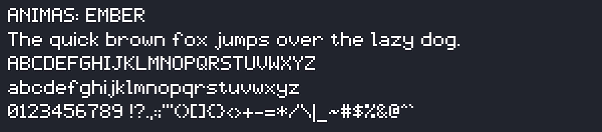

# Developing Animas: Ember

Notes for contributors. For the project overview see the [README](../README.md).

## Running and testing

- **Play:** open `project.godot` in Godot 4.7+ and press **F5** (the main scene is `scenes/maps/town.tscn`).
- **Smoke test (headless, also good for CI):**

  ```bash
  godot --headless --path . --import          # first run only
  godot --headless --path . -s tools/smoke_test.gd
  ```

  It loads the town, walks through the door, bumps a wall, and talks to an NPC, then prints `ALL PASSED` or the failures (non-zero exit code).
- **Website and browser demo:** see [Website](#website) below.

## Project structure

```
project.godot
scenes/
  player.tscn             Player (Node2D + AnimatedSprite2D + RayCast2D + Camera2D)
  npc.tscn                NPC (StaticBody2D + 16x16 CollisionShape2D)
  maps/                   town / house: a .tscn plus a .gd that defines the map
scripts/
  autoload/
    game_state.gd         Input lock, spawn point, story flags
    scene_transition.gd   Fade out -> change scene -> fade in
    dialogue.gd           Typewriter text box, built in code
    touch_controls.gd     On-screen D-pad, A, and DEX buttons (touch devices only)
    encounters.gd         Wild-anima and trainer encounter screens
    anima_dex.gd          The Animadex browser (Esc)
  overworld/
    player.gd             Grid movement, interaction, warp checks
    npc.gd                Talkable StaticBody2D
    warp.gd               Door / route-edge marker
    trainer.gd            Trainer: line of sight, walk-up, challenge
    character_sprite.gd   Draws one character from the characters atlas
    ascii_map.gd          Builds a map from ASCII rows (NPCs, trainers, warps, encounter tables)
    facing.gd             Direction enum + helpers
  data/                   GENERATED: anima_roster.gd, character_roster.gd
assets/
  tilesets/               tiles.png + tiles.tres
  animas/animas.png       Sprite atlas for all 151 animas (generated)
  characters/             characters.png: 31 looks x 12 frames (generated)
  fonts/                  animas_pixel.png + .fnt (bitmap font)
export_presets.cfg        Export presets for every platform (no secrets inside)
.github/workflows/
  build.yml               Test, build all platforms, publish the release
tools/
  generate_tiles.py       Regenerates the placeholder tileset
  generate_font.py        Regenerates the Animas Pixel font
  generate_animas.py      The 151-anima roster, stats, dex text, and sprites (edit FAMILIES)
  anima_art.py            The sprite engine (body shapes, features, palettes) used by the above
  generate_characters.py  The 31 character looks (edit LOOKS)
  build_site_data.py      Regenerates docs/data.js for the website from the game's files
  smoke_test.gd           Headless smoke test
docs/                     Website (index.html, style.css, game.js, assets/), screenshot, developer docs
```

## Website

The project site lives in `docs/` and is deployed to GitHub Pages by `.github/workflows/pages.yml`. **One-time setup:** Settings > Pages > Build and deployment > Source: *GitHub Actions*. After that, every push to `main` that touches `docs/` redeploys it.

| File | What it is |
|------|------------|
| `index.html`, `style.css`, `animas.js` | The landing page, the 151-anima gallery, and the cast. Light and dark themes follow the visitor's system setting. |
| `data.js` | **Generated** by `tools/build_site_data.py` from the game's own maps, roster, cast, and font. |
| `game.js` | A JavaScript port of the starter town (same tileset, same *Animas Pixel* font, same movement rules). It is **not** the Godot build, so NPCs, trainers, and encounter tables are duplicated by hand in its `MAPS` data. The map layouts, roster, cast, and font are not: run `python3 tools/build_site_data.py` after changing them. |
| `assets/` | Copies of the tileset, font, icon, `animas.png`, and `characters.png` used by the page. The generators refresh the animas and characters copies; re-copy the others if you repaint them. |
| `screenshot.png` | README and social-card image. Regenerate with `python3 tools/render_screenshot.py`. |

The download buttons read the newest GitHub Release in the visitor's browser, so new builds show up with no site change. Preview locally with `python3 -m http.server -d docs 8000` and open http://localhost:8000.

## Animas, characters, and trainers

**The roster.** All 151 animas come from `FAMILIES` in `tools/generate_animas.py`: each family lists its stage names, types, body shape, features (gained one per evolution), and a dex blurb. Run `python3 tools/generate_animas.py` to regenerate the sprite atlas and `scripts/data/anima_roster.gd`. Everything is deterministic, so the same input always gives the same sprites. Look things up in code with `AnimaRoster.get_anima(id)`, `AnimaRoster.id_of("Cindle")`, and `AnimaRoster.icon(id)`.

**Characters.** `LOOKS` in `tools/generate_characters.py` defines every look (skin, hair style and color, outfit, accessory). Regenerate with `python3 tools/generate_characters.py`. Use a look by setting `look = "scout"` on an NPC, Trainer, or the Player.

**Adding an NPC or trainer to an ASCII map** (`scenes/maps/*.gd`):

```gdscript
npc_defs = [
	{tile = Vector2i(10, 6), look = "kid_boy", lines = ["Hello!"]},
]
trainer_defs = [
	{tile = Vector2i(9, 5), look = "netter", id = "netter_pim", facing = Facing.Dir.DOWN, range = 4,
		lines = ["Let's battle!"], after = ["You beat me!"],
		team = [{anima = "Fidget", level = 3}, {anima = "Sparkbug", level = 4}]},
]
```

A trainer challenges you when you step into the tiles they face (up to `range`) with nothing solid between. `id` must be unique: it is how the game remembers that you beat them.

**Wild animas.** Set `encounter_table` on a map: `{anima = "Nutkin", min = 2, max = 4, weight = 30}`. Stepping on tall grass has a 20% chance of a roll (`AsciiMap.ENCOUNTER_CHANCE`).

**Animadex.** `Esc` opens it (`AnimaDex` autoload): Up/Down move, Left/Right jump 10, Enter switches between Stats and Info.

## Building and releasing

### Cut a release

```bash
git tag v0.0.2 && git push origin v0.0.2
```

The **Build & Release** workflow (`.github/workflows/build.yml`) runs the smoke test, exports every platform, and attaches the files plus `SHA256SUMS.txt` to a GitHub Release (marked pre-release while the version starts with `v0.`). Use **Actions > Build & Release > Run workflow** to build everything without releasing; the files are kept as workflow artifacts.

| Platform | Presets | Notes |
|----------|---------|-------|
| Windows  | `Windows x86_64`, `x86_32`, `arm64` | Single `.exe` with the `.pck` embedded |
| Linux    | `Linux x86_64`, `x86_32`, `arm64`, `arm32` | Single binary with the `.pck` embedded |
| macOS    | `macOS` | Universal (x86_64 + arm64), ad-hoc signed, not notarized |
| Android  | `Android arm64`, `arm32`, `x86_64`, `x86`, `universal` | APKs, one per CPU plus a universal one |
| iOS      | `iOS` | Opt-in, exports an Xcode project (see below) |

### Android signing (recommended before shipping)

Without secrets, CI signs APKs with a throwaway key so they still install, but **updates will not install over builds signed with a different key**. For stable releases, create a keystore once and add these repository secrets (Settings > Secrets and variables > Actions):

- `ANDROID_KEYSTORE_BASE64`: `base64 -w0 my-release.keystore`
- `ANDROID_KEY_ALIAS`
- `ANDROID_KEY_PASSWORD` (used as both the store and key password)

### iOS

iOS needs an Apple Developer account, so it is off by default. Set the repository **variables** `BUILD_IOS=true` and `APPLE_TEAM_ID=<your team id>`; the workflow then attaches an Xcode project (`...-ios-xcode-project.zip`). Open it in Xcode, set your signing team and provisioning profile, and archive. Producing an installable `.ipa` directly in CI would additionally need your signing certificate and profile stored as secrets.

### Exporting locally

Install the 4.7 export templates in the editor (**Editor > Manage Export Templates**), then:

```bash
godot --headless --path . --import
godot --headless --path . --export-release "Linux x86_64" build/AnimasEmber-linux-x86_64.x86_64
```

Preset names are in `export_presets.cfg`. Android additionally needs the Android SDK and JDK 17 configured in **Editor Settings > Export > Android**.

## Font

The game uses **Animas Pixel**, a bitmap font drawn from scratch: 5 px wide, 7 px caps, 5 px x-height, 2 px descenders, proportional spacing, ASCII only. Glyphs are defined as ASCII-art rows in `tools/generate_font.py`; run `python3 tools/generate_font.py` to rewrite `assets/fonts/animas_pixel.png`, `.fnt`, and `docs/font_preview.png`. Assign it to a control with `add_theme_font_override("font", load("res://assets/fonts/animas_pixel.fnt"))` and always use its native size (`font_size = 9`) so it stays crisp; `Dialogue` and the touch buttons already do both.



## How it works

- **Movement** is a tween of exactly one tile (`TILE = 16`). Before each step a `RayCast2D` checks the destination tile for collisions. Solid tiles and NPCs both block it.
- **Interaction** casts the same ray in the facing direction and calls `interact()` on whatever it hits.
- **Warps** are not physics objects: after each step the player compares its tile against every node in the `warps` group.
- **Input locking:** `GameState.input_locked` is set during dialogue and scene transitions.
- **Autoloads** (`GameState`, `SceneTransition`, `Dialogue`) are registered in `project.godot`.

## Adding a map

**Option A: ASCII (quick prototypes).** Copy `scenes/maps/house.tscn` and `house.gd`, then edit `_setup()`: set `rows`, `start_tile`, `npc_defs`, and `warp_defs`. The legend is in `ascii_map.gd` (`.` grass, `g` tall grass, `T` tree, `w` water, `#` stone wall, and so on).

**Option B: paint it in the editor (real maps).**
1. New scene with a `Node2D` root, saved in `scenes/maps/`.
2. Add a `TileMapLayer`, load `assets/tilesets/tiles.tres` as its Tile Set, and paint. Solid tiles already carry collision.
3. Instance `scenes/player.tscn` and set the Camera2D limits to your map bounds.
4. Add NPCs and warps (below).

### Adding an NPC

Instance `scenes/npc.tscn`, drop it on a tile, and edit **Dialogue** in the Inspector (each entry is one text box). Without an `AnimatedSprite2D` it draws a placeholder person; set **Body Color** / **Hair Color** to vary it.

### Adding a door or route exit

1. Add a `Marker2D`, attach `scripts/overworld/warp.gd`, and place it on the trigger tile.
2. Set **Target Scene**, **Target Tile** (tile coordinates, e.g. `(5, 12)`), and **Target Facing**.
3. Add a matching `Warp` in the other map for the way back.

### Real character sprites

Give the Player's (or an NPC's) `AnimatedSprite2D` a `SpriteFrames` with animations named `idle_down`, `idle_up`, `idle_left`, `idle_right`, `walk_down`, `walk_up`, `walk_left`, `walk_right`. Missing animations are skipped, and the placeholder is hidden once frames are set.

## Tiles

`assets/tilesets/tiles.png` is an original 8x4 sheet of 16x16 tiles, and `tiles.tres` is the ready-made Godot `TileSet` for it (collision on solid tiles, plus a `tall_grass` custom data flag).


| Row | Col 0 | Col 1 | Col 2 | Col 3 | Col 4 | Col 5 | Col 6 | Col 7 |
|-----|-------|-------|-------|-------|-------|-------|-------|-------|
| 0 | grass | grass tufts | flowers | **tall grass** (encounters) | path | sand | water* | *(free)* |
| 1 | tree* | bush* | fence* | sign* | stone wall* | wood floor | carpet | red roof* |
| 2 | blue roof* | house wall* | window wall* | door | door mat | counter* | bookshelf* | ledge* |
| 3 | *(free)* | *(free)* | *(free)* | *(free)* | *(free)* | *(free)* | *(free)* | *(free)* |

\* = solid (blocks the player). Door tiles are walkable on purpose: put a `Warp` on them.

### Using your own art

- **Repaint in place:** open `tiles.png` in Aseprite / LibreSprite / Piskel / GIMP and paint over the tiles. Keep the 16x16 grid and 8 columns. Collision and flags are by position, so nothing else changes.
- **Add tiles:** draw into a free slot (row 3 and column 7 are empty). In Godot, open the `TileSet` bottom panel, select the tile in the atlas, and enable it. Add a collision polygon under **Physics** if it should block, and tick **tall_grass** under **Custom Data** if it should trigger encounters.
- **Bigger sheets:** add more rows freely. For another sheet, add a second atlas source in the TileSet panel.
- **Regenerate the placeholders:** `pip install pillow && python3 tools/generate_tiles.py` rewrites `tiles.png`, `tiles.tres`, and the preview from the table at the bottom of the script (which also controls which tiles are solid). Note this overwrites any repainting, so use it **or** hand-paint, not both.

### Tall grass

The `tall_grass` custom data layer is on the tall-grass tile. `AsciiMap` already reads it on `Player.stepped` with `tile_data.get_custom_data("tall_grass")` and rolls a 20% placeholder encounter. Phase 2 will replace that with real wild encounters.
