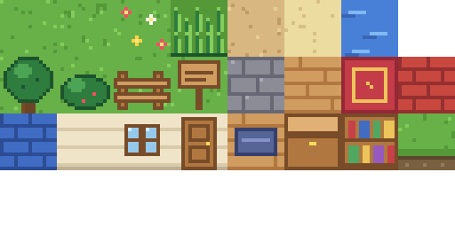

# Developing Pixel Pulse RPG

Notes for contributors. For the project overview see the [README](../README.md).

## Running and testing

- **Play:** open `project.godot` in Godot 4.3+ and press **F5** (the main scene is `scenes/maps/town.tscn`).
- **Smoke test (headless, also good for CI):**

  ```bash
  godot --headless --path . --import          # first run only
  godot --headless --path . -s tools/smoke_test.gd
  ```

  It loads the town, walks through the door, bumps a wall, and talks to an NPC, then prints `ALL PASSED` or the failures (non-zero exit code).
- **Browser demo:** `docs/index.html` is a standalone JavaScript port of the same maps and mechanics. It is served by GitHub Pages and is not part of the Godot build.

## Project structure

```
project.godot
scenes/
  player.tscn             Player (Node2D + AnimatedSprite2D + RayCast2D + Camera2D)
  npc.tscn                NPC (StaticBody2D + 16x16 CollisionShape2D)
  maps/                   town / house: a .tscn plus a .gd that defines the map
scripts/
  autoload/
    game_state.gd         Input lock, spawn point, story flags
    scene_transition.gd   Fade out -> change scene -> fade in
    dialogue.gd           Typewriter text box, built in code
  overworld/
    player.gd             Grid movement, interaction, warp checks
    npc.gd                Talkable StaticBody2D
    warp.gd               Door / route-edge marker
    ascii_map.gd          Builds a map from ASCII rows at runtime
    placeholder_sprite.gd Placeholder character art
    facing.gd             Direction enum + helpers
assets/tilesets/          tiles.png + tiles.tres
tools/
  generate_tiles.py       Regenerates the placeholder tileset
  smoke_test.gd           Headless smoke test
docs/                     Developer docs, tile preview, browser demo (index.html)
```

## How it works

- **Movement** is a tween of exactly one tile (`TILE = 16`). Before each step a `RayCast2D` checks the destination tile for collisions. Solid tiles and NPCs both block it.
- **Interaction** casts the same ray in the facing direction and calls `interact()` on whatever it hits.
- **Warps** are not physics objects: after each step the player compares its tile against every node in the `warps` group.
- **Input locking:** `GameState.input_locked` is set during dialogue and scene transitions.
- **Autoloads** (`GameState`, `SceneTransition`, `Dialogue`) are registered in `project.godot`.

## Adding a map

**Option A: ASCII (quick prototypes).** Copy `scenes/maps/house.tscn` and `house.gd`, then edit `_setup()`: set `rows`, `start_tile`, `npc_defs`, and `warp_defs`. The legend is in `ascii_map.gd` (`.` grass, `g` tall grass, `T` tree, `w` water, `#` stone wall, and so on).

**Option B: paint it in the editor (real maps).**
1. New scene with a `Node2D` root, saved in `scenes/maps/`.
2. Add a `TileMapLayer`, load `assets/tilesets/tiles.tres` as its Tile Set, and paint. Solid tiles already carry collision.
3. Instance `scenes/player.tscn` and set the Camera2D limits to your map bounds.
4. Add NPCs and warps (below).

### Adding an NPC

Instance `scenes/npc.tscn`, drop it on a tile, and edit **Dialogue** in the Inspector (each entry is one text box). Without an `AnimatedSprite2D` it draws a placeholder person; set **Body Color** / **Hair Color** to vary it.

### Adding a door or route exit

1. Add a `Marker2D`, attach `scripts/overworld/warp.gd`, and place it on the trigger tile.
2. Set **Target Scene**, **Target Tile** (tile coordinates, e.g. `(5, 12)`), and **Target Facing**.
3. Add a matching `Warp` in the other map for the way back.

### Real character sprites

Give the Player's (or an NPC's) `AnimatedSprite2D` a `SpriteFrames` with animations named `idle_down`, `idle_up`, `idle_left`, `idle_right`, `walk_down`, `walk_up`, `walk_left`, `walk_right`. Missing animations are skipped, and the placeholder is hidden once frames are set.

## Tiles

`assets/tilesets/tiles.png` is an original 8x4 sheet of 16x16 tiles, and `tiles.tres` is the ready-made Godot `TileSet` for it (collision on solid tiles, plus a `tall_grass` custom data flag).



| Row | Col 0 | Col 1 | Col 2 | Col 3 | Col 4 | Col 5 | Col 6 | Col 7 |
|-----|-------|-------|-------|-------|-------|-------|-------|-------|
| 0 | grass | grass tufts | flowers | **tall grass** (encounters) | path | sand | water* | *(free)* |
| 1 | tree* | bush* | fence* | sign* | stone wall* | wood floor | carpet | red roof* |
| 2 | blue roof* | house wall* | window wall* | door | door mat | counter* | bookshelf* | ledge* |
| 3 | *(free)* | *(free)* | *(free)* | *(free)* | *(free)* | *(free)* | *(free)* | *(free)* |

\* = solid (blocks the player). Door tiles are walkable on purpose: put a `Warp` on them.

### Using your own art

- **Repaint in place:** open `tiles.png` in Aseprite / LibreSprite / Piskel / GIMP and paint over the tiles. Keep the 16x16 grid and 8 columns. Collision and flags are by position, so nothing else changes.
- **Add tiles:** draw into a free slot (row 3 and column 7 are empty). In Godot, open the `TileSet` bottom panel, select the tile in the atlas, and enable it. Add a collision polygon under **Physics** if it should block, and tick **tall_grass** under **Custom Data** if it should trigger encounters.
- **Bigger sheets:** add more rows freely. For another sheet, add a second atlas source in the TileSet panel.
- **Regenerate the placeholders:** `pip install pillow && python3 tools/generate_tiles.py` rewrites `tiles.png`, `tiles.tres`, and the preview from the table at the bottom of the script (which also controls which tiles are solid). Note this overwrites any repainting, so use it **or** hand-paint, not both.

### Tall grass

The `tall_grass` custom data layer is on the tall-grass tile. `AsciiMap` already reads it on `Player.stepped` with `tile_data.get_custom_data("tall_grass")` and rolls a 20% placeholder encounter. Phase 2 will replace that with real wild encounters.
